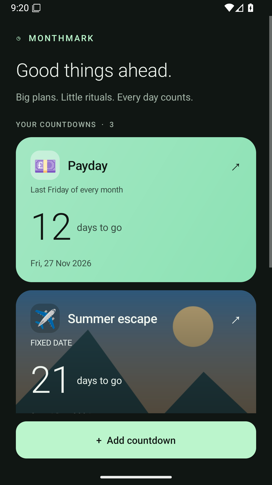
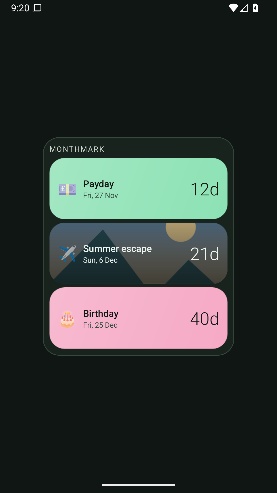

# Monthmark

A small native Android app for the days you're looking forward to.

- Multiple named countdowns: “Days to payday”, “Holiday”, “Birthday”…
- Fixed calendar dates, or the last / second-last / third-last / fourth-last occurrence of any weekday every month.
- Monthly countdowns stay due for the entire day and roll forward the following day.
- Small (2 × 2), medium (4 × 2), and large (4 × 4) home-screen widgets, all resizable.
- Select one or several countdowns for each widget. Wider/taller widgets show up to four, nearest first. Smaller widgets show the nearest and indicate how many more are selected.
- Ten colour palettes, twenty event icons, and your own photo backgrounds on cards and widgets.
- A live appearance preview in the editor, edit/delete, next-date previews, and days-since for past fixed dates.
- Photos are copied into app storage, so the countdown keeps its background after the source image is moved or removed.
- Offline, no accounts, no ads, no internet permission. Android 8.0+.

## Screenshots

Captured in the Android 16 cloud emulator with sample countdowns and a generated test landscape. The widget previews use Android's native widget host; the placement test also exercises Pixel Launcher.

 

[Small widget](docs/screenshots/widget-small.png) · [Medium widget](docs/screenshots/widget-medium.png) · [Large widget](docs/screenshots/widget-large.png)

## Install

Download `Monthmark.apk` from [Releases](https://github.com/mallison/monthmark-android/releases/latest) on your Android phone. Allow installation from your browser when Android asks, then open the APK.

Install updates over the existing app to keep your countdowns.

Add a countdown, tap its card, then **Add home-screen widget**. Or touch and hold an empty space on your home screen → **Widgets** → **Monthmark**. On Android 12+, dropping a widget shows a useful default immediately: the nearest countdown for small widgets, or multiple countdowns for larger ones. **Tap the placed widget to choose its countdowns.** This avoids making successful placement depend on a launcher configuration-activity result. Older Android versions open the chooser during placement.

Touch and hold a widget to resize it. Each widget has its own selection. To personalise a countdown, tap its card → **Edit countdown**, then choose its colour, icon or background photo.

Widget dimensions depend on your launcher. There is no ongoing background service: date refreshes use a midnight alarm and Android's periodic widget update. Android can defer updates during deep sleep or aggressive battery saving.

The supplied APK is a debug-signed personal build, not a Play Store release. The original repository keeps a stable signing key in a GitHub Actions secret, so later builds can update the app while keeping data. Forks need their own stable signing key. Android device backup may include the app's local preferences if enabled on your phone.

## Build entirely in the cloud

[Open in GitHub Codespaces](https://codespaces.new/mallison/monthmark-android). The dev container installs Java 17 and Android SDK tools. No Android Studio installation is required on your computer. Codespaces usage depends on your GitHub allowance.

GitHub Actions builds and checks each push or pull request. Open **Actions → Android cloud build** to run it manually. Each successful run supplies a `monthmark-apk-api-35` or `monthmark-apk-api-36` artifact. The workflow runs app, photo import, real widget host and Pixel Launcher drag-and-drop tests on Android 15 and Android 16, then uploads screenshots and test reports. Android 17 has not been tested in the cloud runner because its SDK feed currently lacks that system image.

```sh
./gradlew :core:test :app:lintDebug :app:assembleDebug
```

The `core` module contains pure Java date rules, including a 400-year Gregorian calendar test across every weekday and supported monthly offset. `app` uses native Android Views, SharedPreferences and RemoteViews with no production third-party dependencies.

## Development

Java 17+, Gradle 8.9 (wrapper included), Android SDK 35. Set `ANDROID_HOME`, or set `sdk.dir` in an untracked `local.properties`. With an emulator running:

```sh
./gradlew :app:connectedDebugAndroidTest
```

To preserve APK update compatibility in another repository, generate your own Android debug keystore and save its base64 encoding as the Actions secret `MONTHMARK_DEBUG_KEYSTORE_BASE64`. Never commit the keystore. There are no API keys or runtime services to configure.
